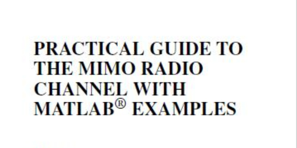

# Practical Guide to MIMO Radio Channel with MATLAB Examples

The book introduces the concept of Multi-Input Multi-Output (MIMO) radio channels, a smart communication method based on using multiple antennas. Additionally, the author summarizes the channel modeling methods currently used in industry, academia, and standardization bodies. The structure of the book allows readers to easily navigate through each chapter to understand the basic principles and mathematical foundations behind MIMO. It also provides examples (i.e., Kroenecker model, Weicheselberger model, geometric and deterministic models, and light-tracing), system scenarios, trade-offs, and visual explanations. The author explains and demonstrates the use and application of these models at the system level.

Table of Contents  
Preface IX  
Abbreviations List XIII  
Symbol List XVII  
1 Introduction 1  
1.1 From SISO to MISO/SIMO to MIMO 2  
1.1.1 Single Input Single Output SISO 2  
1.1.2 Single Input Multiple Output, SIMO, Multi-Input Single Output, MISO 3  
1.1.3 Multi-Input Multi-Output, MIMO 6  
1.2 What do we need MIMO for? 7  
1.2.1 Single user perspective 8  
1.2.2 Multi-user perspective 8  
1.3 How does MIMO work? Two analogies 10  
1.3.1 Single user perspective 10  
1.3.2 Multi-user perspective 12  
1.4 Conditions for MIMO to work 13  
1.5 When was MIMO around? 14  
1.6 Where is MIMO used? 15  
1.7 Purpose of this book 16  
2 Capacity of MIMO Channels 17  
2.1 Some background of digital communication systems 18  
2.1.1 Generation of digital signals 18  
2.1.2 Transmission conversion/formatting 19  
2.1.3 Complex baseband representation 19  
2.1.4 Decoder 19  
2.2 Concept of capacity 20
2.2.1 Abstraction communication system
2.2.2 Capacity definition
2.2.3 Realization of receiver and transmitter capacity
2.3 Channel state information and fading
2.3.1 Fast slow fading
2.3.2 Channel state information
2.4 Narrowband MIMO model
2.5 Time-invariant channel capacity
2.5.1 Time-invariant SISO channel capacity
2.5.2 Time-invariant SIMO channel capacity
2.5.3 Time-invariant MFSK channel
2.5.4 Time-invariant MIMO channel: a set of parallel independent AWGN channels
2.5.5 Maximal achievable rate with fixed input covariance matrix
2.6 Fast fading channel with CSIT distribution: throughput capacity
2.6.1 Throughput: basic principles
2.6.2 Fast fading SISO channel with CSIT distribution
2.6.3 Fast fading SIMO channel with CSIT distribution
2.6.4 Fast fading MISO channel with CSIT distribution
2.6.5 Fast fading MIMO channel with CSIT distribution
2.7 Slow fading channel with CSIT distribution: outage probability and outage capacity
2.7.1 Outage: basic principles
2.7.2 Diversity to improve communication reliability
2.7.3 Slow fading SISO channel with CSIT distribution
2.7.4 Slow fading SIMO channel with CSIT distribution: receive diversity
2.7.5 Slow fading MISO channel with CSIT distribution: transmission diversity
2.7.6 Slow fading MIMO channel with CSIT distribution
2.8 Chapter summary table
2.9 Extended reading
3 MIMO transceivers
3.1 MIMO Receiver
3.1.1 General MIMO Architecture
3.1.2 Maximum Likelihood Receiver
3.1.3 Chapter 78 Considered Receiver Classes
3.1.4 Spatial Matching Filter
3.1.5 Zero-Forced Receiver
3.1.6 MMSE Receiver
3.1.7 SIC Receiver and V-Blast
3.1.8 Performance
3.2 Transmitter and Receiver with CSI: Transmit and Receive Beamforming
3.2.1 Beamforming Principle
3.2.2 Multi-Transmit and Receive Beams
3.2.3 Transmit Beamforming (MISO System)
3.2.4 Receive Beamforming
3.2.5 Single Beam MIMO: Maximum Eigenvector Beamforming
3.2.6 Eigenmode Transfer
3.2.7 Performance of Beamforming Schemes
3.3 Spatiotemporal Block Codes
3.3.1 Orthogonal Design for 2×1 MISO Systems: Alamouti STBC
3.3.2 STBC for More Than Two Transmit Antennas
3.4 D-Explosion
3.4.1 Diagonal Coding
3.4.2 Diagonal Decoding
3.4.3 D-Blast: Best Interruption
3.4.4 Performance Improvement
3.4.5 Error Propagation
3.4.6 Numerical Evaluation: D-Blast vs. STBC
3.5 Chapter Summary Table
3.6 Extended Reading
4 MIMO Channel Models
4.1 SISO Models and Channel Fundamentals
4.1.1 Power Prediction Model
4.1.2 Channel Time Variable Prediction Model
4.1.3 Narrowband and Wideband Channels
4.1.4 Polarization
4.1.5 Summary of SISO Channel Modeling Parameters
4.2 Challenges in MIMO Channel Modeling
4.2.1 Deterministic Model
4.2.2 Random Model
4.3 Summary
5 MIMO Antenna Design
5.1 Fundamentals of Antenna Elements
5.1.1 Anisotropic Heat Sinks
5.1.2 Directivity and Gain
5.1.3 Far Field and Rayleigh Distance
5.1.4 Three-Dimensional Antenna Patterns
5.1.5 Impedance and Return Loss
5.1.6 Mutual Reception
5.1.7 Antenna Polarization
5.1.8 Average Effective Gain
5.2 Single Antenna Design
5.3 Designing MIMO Array Antennas
5.3.1 Spatial Correlation
5.3.2 Angle and Polarization Correlation
5.3.3 Uniform Arrival Angle Impact
5.4 Effects of Antenna Design on MIMO Radio Channels
5.5 Assessing the Impact of Antennas on MIMO Channels
5.5.1 Rough Evaluation of Antennas' Impact on MIMO Channel Capacity
5.5.2 Advanced Technologies for Evaluating MIMO Antenna Performance
5.6 Challenges and Examples of Compact MIMO Antenna Design
5.7 Summary
5.7.1 Antenna Foundations
5.7.2 Designing Antenna Arrays
5.7.3 Practical Antennas for MIMO
6 Current and Future Standards in MIMO
6.1 Wireless Channel Modeling in Standards
6.2 Current MIMO-based wireless standards and corresponding channel models
6.2.1 IEEE 802.11n 228
6.2.2 IEEE 802.16–WiMAX 231
6.2.3 3GPP-LTE 235
6.2.4 Comparison of IEEE 802.11n, WiMAX, and 3GPP models
6.3 Other areas with MIMO
6.3.1 MIMO for DVB-T2 240
6.3.2 High frequency MIMO 241
6.3.3 Satellite communication MIMO 242
6.3.4 Ultra-wideband MIMO 242
6.3.5 For onboard communication MIMO 243
6.3.6 In-vehicle communication MIMO 244
6.3.7 In-vehicle communication MIMO in small cell environments 244
6.4 Conclusion and future wireless systems
Appendix: Some useful definitions
References
Index

## Images

<!-- PAYMENT_BLOCK -->

## Get this dataset

- Payment link (Stripe): [Buy now](https://buy.stripe.com/3cs8yP7sY87d0vu9AB)
- Payment QR code: 

<!-- /PAYMENT_BLOCK -->
